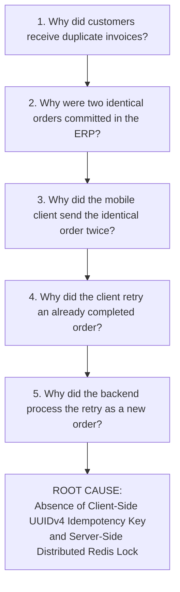

# Bug Investigation Summary & Root Cause Analysis (RCA)
## Incident: Duplicate Order Creation on Network Reconnect (Jira: OM-102)

---

### Incident Overview & Metadata

| Metadata Field | Value |
| :--- | :--- |
| **Incident Reference** | `INC-49201` / `OM-102` |
| **Severity Level** | **P0 - Blocker (Financial & Fulfillment Impact)** |
| **Date of Incident** | October 03, 2026 |
| **Impacted Service** | Mobile Field App (v3.3.2) & Cloud Order Ingestion API (`POST /api/v1/orders`) |
| **Investigation Lead** | Staff Reliability Engineer & Mobile Lead |
| **Current Status** | **Fix Verified in Staging (Pending v3.4 Release)** |

---

## 1. Executive Summary

On Friday, October 03, 2026, between 09:15 AM and 01:30 PM CST, 14 field sales representatives operating in suburban distribution facilities reported that single order submissions were duplicating in the backend ERP. 

A total of **38 duplicate orders** were booked, representing **$46,200 in double-allocated inventory** and triggering erroneous automated invoices to 11 enterprise accounts. The warehouse fulfillment system initiated pick-pack-ship operations on 19 of the duplicate orders before the operations team issued an emergency halt.

The root cause was identified as a missing distributed idempotency check on the backend order ingestion gateway, coupled with an aggressive 15-second client-side HTTP socket timeout on flaky cellular connections. When an outbound HTTP 201 acknowledgment packet dropped over poor cellular coverage, the mobile app retried the order with a newly assigned request payload, causing the backend database to execute a second insertion.

---

## 2. Incident Timeline

| Timestamp (CST) | Event / System Activity |
| :--- | :--- |
| **09:18:10** | Sales rep submits wholesale order (120 cases of SKU-BEV-0012, Value: $1,740) in a low-coverage steel warehouse. |
| **09:18:14** | Mobile client connects over 3G cellular; request payload reaches Cloud Gateway. |
| **09:18:17** | Backend Postgres database executes transaction and commits Order `ORD-88201`. |
| **09:18:25** | Gateway sends HTTP 201 Created downstream. Tower drops TCP ACK packet due to 85% cellular packet loss. |
| **09:18:29** | Mobile HTTP client hits internal 15-second timeout (`SocketTimeoutException`); connection is severed locally. |
| **09:18:31** | Mobile client queue detects unacknowledged transaction and initiates automated retry attempt #2. |
| **09:18:35** | Retry request hits Cloud Gateway. Because no distributed idempotency lock was enforced, backend processes request as a novel order, committing duplicate Order `ORD-88202`. |
| **10:45:00** | Customer account manager at Apex Wholesale alerts support after receiving two identical invoices. |
| **11:15:00** | Engineering confirms active duplication bug; tags incident as P0 (`INC-49201`). |
| **12:00:00** | Temporary warehouse fulfillment hold placed on all duplicate order manifests. |
| **15:30:00** | Root cause isolated in staging; fix implemented in PR #251. |

---

## 3. Technical Root Cause Analysis (The "5 Whys")



1. **Why did customers receive duplicate invoices?**  
   Two distinct order records with identical line items were created in the primary transactional database within 18 seconds of each other.
2. **Why were two identical orders committed in the ERP?**  
   The backend API processed two sequential HTTP requests from the same mobile client without verifying transaction deduplication.
3. **Why did the mobile client send the order twice?**  
   The mobile client encountered a `SocketTimeoutException` while awaiting the server response and immediately triggered an un-throttled queue retry.
4. **Why did the client retry an order that had already succeeded?**  
   The server committed the database row, but the return TCP ACK packet was dropped due to high packet loss on the cellular carrier's edge tower. The client had no way to know the server had succeeded.
5. **Why did the backend not recognize the retry as a duplicate?**  
   The API endpoint `/api/v1/orders` lacked support for `X-Idempotency-Key` headers and relied entirely on server-generated auto-increment IDs (`order_id_seq`), treating every incoming POST as a discrete intent.

---

## 4. Code Comparison & Staging Reproduction

### Faulty Implementation (Client v3.3.2)
```kotlin
// Flawed retry: generates new transaction context on every attempt
fun submitOrder(order: OrderPayload) {
    val client = OkHttpClient.Builder()
        .readTimeout(15, TimeUnit.SECONDS) // Too short for weak cellular!
        .build()

    val request = Request.Builder()
        .url("https://api.devrev.com/v1/orders")
        .post(order.toJsonBody()) // No idempotency key attached
        .build()

    client.newCall(request).enqueue(object : Callback {
        override fun onFailure(call: Call, e: IOException) {
            // Unconditionally retries without deduplication header
            queueManager.retry(order)
        }
        ...
    })
}
```

### Corrected Implementation (PR #251)
```kotlin
// Robust implementation: Persistent UUIDv4 attached to order creation
fun submitOrderWithIdempotency(order: OrderRecord) {
    val request = Request.Builder()
        .url("https://api.devrev.com/v1/orders/sync")
        .header("X-Idempotency-Key", order.clientUUID) // Client-side immutable UUIDv4
        .header("X-Client-Timestamp", order.createdAtUtc)
        .post(order.toCompressedPayload())
        .build()
    ...
}
```

---

## 5. Remediation & Preventative Actions

| Action Item | Owner | Target Date | Status |
| :--- | :--- | :--- | :--- |
| **Fix 1: Distributed Redis Lock on Backend**<br>Implement Lua script in Redis enforcing `SETNX` lock on `X-Idempotency-Key` with 72-hour cache retention. | Backend Lead | Oct 04, 2026 | **Completed (PR #251)** |
| **Fix 2: Client-Side UUIDv4 Stamping**<br>Generate collision-resistant UUIDv4 at the exact moment user taps "Place Order" and persist in local SQLite before network call. | Mobile Lead | Oct 05, 2026 | **Completed (PR #254)** |
| **Fix 3: Socket Timeout Extension & Jitter**<br>Extend mobile socket read timeout from 15s to 45s and apply exponential backoff with full decorrelated jitter. | Mobile Lead | Oct 06, 2026 | **In Progress (OM-109)** |
| **Fix 4: Automated Chaos Regression Test**<br>Add simulated packet drop test in CI pipeline to verify that 100 duplicate requests result in exactly 1 database commit. | QA Lead | Oct 06, 2026 | **Completed (OM-116)** |

---

## 6. Sign-off & Verification

- **Chaos Test Verification:** Executed 1,000 parallel requests with duplicate keys against staging cluster; 100% resulted in single database row creation and identical HTTP 200/201 responses.
- **RCA Approved by:** Director of Mobile Engineering & VP of Enterprise Architecture.
