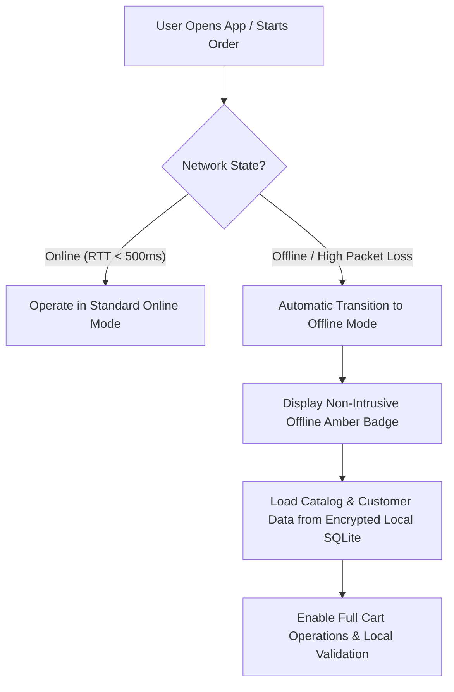
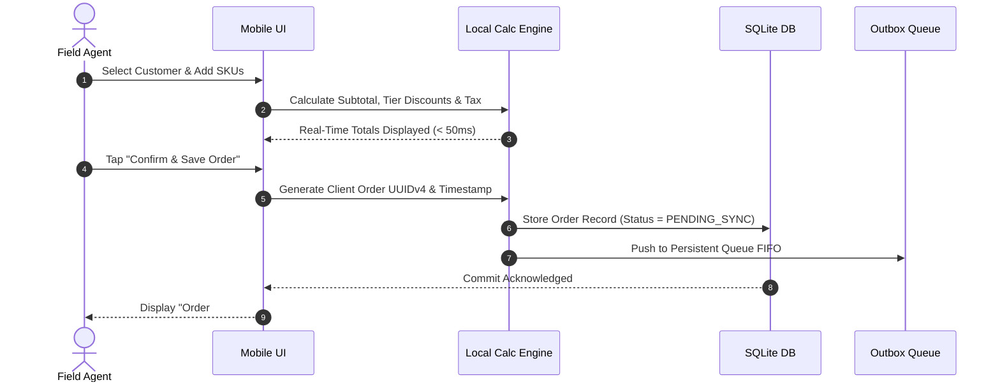

# Product Requirement Document (PRD)
## Offline Mode for Mobile Order Processing

---

### Document Control & Metadata

| Field | Detail |
| :--- | :--- |
| **Document Title** | Offline Mode for Mobile Order Processing (OM-MOP) |
| **Document Status** | `Ready for Review (RFC)` |
| **Target Release** | Mobile App v3.4 (Q3 2026) |
| **Owner / Lead PM** | Product Management Team |
| **Tech Leads** | Mobile Engineering Lead & Backend Systems Lead |
| **Target Platforms** | iOS & Android (Cross-platform Core) |
| **Target Users** | Field Sales Representatives, Mobile POS Cashiers, Delivery & Logistics Agents |

---

## 1. Executive Summary & Problem Statement

### 1.1 Executive Summary
Mobile order processing is a mission-critical function for field sales representatives, pop-up store merchants, and route delivery personnel. These workers frequently operate in connectivity "dead zones"—including warehouse basements, rural client sites, crowded trade shows, and underground retail venues. 

Currently, our mobile application relies on real-time internet connectivity to validate SKUs, calculate taxes, verify customer credit, and submit transactions. Any network interruption during order entry results in blocked sales, dropped carts, and significant frustration. 

**Offline Mode for Mobile Order Processing** introduces an "offline-first" architecture that enables users to browse cached catalogs, build orders, apply pricing and discounts, and commit orders locally without an active network connection. Once connectivity is restored, a robust background synchronization engine automatically pushes queued transactions to the cloud with idempotent guarantees and deterministic conflict resolution.

### 1.2 Problem Statement
- **Sales Dropped in Transit:** Over 38% of field sales visits occur in low, unstable, or non-existent cellular coverage (Edge/3G or 0 bars). Field agents experience checkout timeouts, causing an average of 14% cart abandonment at the point of customer conversation.
- **Manual Workarounds & Inefficiency:** When the app fails, agents resort to paper order pads or chat applications (e.g., WhatsApp). This leads to manual re-entry delays (averaging 5.2 hours per batch), transcription errors (estimated at 6.3% of offline orders), and delayed billing.
- **Poor Customer Experience:** Customers expect instant confirmation and transparent receipt generation. Delays in booking orders lead to inventory discrepancies and double-booking of high-demand inventory.
- **Quantified Business Impact:** Customer interviews and field telemetry indicate an estimated **$1.8M in lost or delayed quarterly revenue** and a **-16 point NPS detractor impact** among field operations staff.

---

## 2. Goals & Success Metrics

### 2.1 Primary Objectives
1. **Uninterrupted Workflow:** Enable field personnel to process end-to-end orders without any network dependencies.
2. **Zero Data Loss:** Ensure 100% of locally committed orders are securely stored on-device and reliably synced once back online.
3. **Transparent Conflict Handling:** Provide automated resolution for 95%+ of edge cases (e.g., price book updates, stock depletion) and an intuitive manual override dashboard for exceptions.
4. **Instant Responsiveness:** Ensure local order creation, SKU search, and cart calculations respond in under 100ms.

### 2.2 Success Metrics (KPIs)

| Metric Type | Metric Name | Baseline (Online-Only) | Target (Offline Mode) | Measurement Method |
| :--- | :--- | :--- | :--- | :--- |
| **North Star** | **Offline Order Completion Rate** | 0% (blocked) | **> 99.5%** successful syncs | Telemetry: Orders synced / Orders created offline |
| **Operational** | **Order Entry Time in Field** | 4.8 minutes (due to retries) | **< 1.5 minutes** | In-app session duration timer |
| **Reliability** | **Sync Success Latency** | N/A | **< 3 seconds** for 20 orders | Time elapsed from reconnect to cloud ACK |
| **Quality** | **Inventory Conflict Override Rate**| N/A | **< 0.8%** of offline orders | Backend reconciliation logs |
| **Adoption** | **Field Agent CSAT / NPS** | CSAT: 62% / NPS: +4 | **CSAT: > 88% / NPS: +35** | In-app 30-day post-rollout survey |

### 2.3 Non-Goals (Out of Scope for v1.0)
- **Real-Time Global Inventory Locking:** Reserving inventory in real time across other sales channels while disconnected (fundamentally bounded by CAP theorem; addressed via optimistic allocation and safety stock).
- **Unattended Offline Credit Card Terminal Processing:** Storing raw credit card PAN data offline without an encrypted PCI-PTS certified EMV card reader. (v1.0 supports: Invoiced/On-Account, Cash, Pre-authorized Credit Limit, and Tokenized Payment on Sync).
- **Peer-to-Peer Mesh Syncing:** Syncing orders device-to-device via Bluetooth/Wi-Fi Direct before reaching the cloud (planned for v2.0).

---

## 3. User Personas & Use Cases

### 3.1 Target Personas

```
┌─────────────────────────────────┐      ┌─────────────────────────────────┐
│  Persona A: Alex Rivera         │      │  Persona B: Priya Patel         │
│  Role: B2B Field Sales Rep      │      │  Role: Pop-Up Event Cashier     │
│  Context: Rural wholesale routes│      │  Context: Outdoor Trade Shows   │
│  Pain: Low signal at warehouses │      │  Pain: Network congestion       │
│  Need: Quick catalog & invoice  │      │  Need: Fast checkout line speed │
└─────────────────────────────────┘      └─────────────────────────────────┘
```

#### Persona A: Alex Rivera – B2B Field Sales Representative
- **Context:** Visits 12–15 convenience stores and distribution centers per day. Many client inventory rooms are located in steel-reinforced basements with zero cellular signal.
- **Workflow:** Alex selects the store account, browses the negotiated contract catalog, scans item barcodes, applies custom volume discounts, collects customer signature, and books the order.
- **Pain Point:** Currently, the app spins on checkout and throws an HTTP 504 error, forcing Alex to write the order on paper and re-enter it at 7 PM from home.

#### Persona B: Priya Patel – Pop-Up Store / Event Cashier
- **Context:** Operates temporary exhibition booths and mobile pop-up events where 10,000+ attendees saturate the local mobile towers.
- **Workflow:** High-velocity sales (30+ transactions per hour) with rapid cart additions and receipts issued via SMS/email queued for delivery.
- **Pain Point:** Dropped packets freeze the payment and order confirmation screen, backing up queues and causing customer walkouts.

---

## 4. Proposed Solution & Core Architecture

### 4.1 Solution Overview
The application will transition from an **"Online-Dependent"** model to an **"Offline-First"** architecture. 

```
┌────────────────────────────────────────────────────────────────────────┐
│                          MOBILE CLIENT                                 │
│                                                                        │
│  ┌──────────────┐      ┌─────────────────────┐      ┌───────────────┐  │
│  │ UI / Order   │ ───► │  Optimistic Local   │ ───► │ Encrypted     │  │
│  │ Entry Screen │      │  Calculation Engine │      │ SQLite Store  │  │
│  └──────────────┘      └─────────────────────┘      └──────┬────────┘  │
│                                                            │           │
│                                                     ┌──────▼────────┐  │
│                                                     │ Outbox Sync   │  │
│                                                     │ Queue Manager │  │
│                                                     └──────┬────────┘  │
└────────────────────────────────────────────────────────────┼───────────┘
                                                             │ HTTPS (TLS 1.3)
                                                             │ Idempotent Sync
                                                      ┌──────▼────────┐
                                                      │ CLOUD BACKEND │
                                                      │  API Gateway  │
                                                      └───────────────┘
```

The system comprises five core pillars:
1. **Local Persistent Cache (SQLite + SQLCipher):** Stores product catalogs, prices, discount tables, customer profiles, and cached credit limits.
2. **Optimistic Local Calculation Engine:** Evaluates price rules, taxes, tiers, and validation locally with zero network hops.
3. **Transactional Outbox Queue:** Commits orders to an on-device FIFO queue with an immutable local status (`QUEUED_OFFLINE`).
4. **Idempotent Background Synchronization Service:** Actively monitors network quality, throttles payload bursts, and pushes orders using deterministic UUIDs.
5. **Conflict Resolution & Reconciliation Layer:** Applies server-side rules for stock reconciliation, price changes, and customer limit overrides.

---

## 5. Key Workflows & User Journeys

### 5.1 Workflow 1: Offline Detection & Seamless Transition



- **Mechanism:** Dual-layer network detection combining OS network interface events (Wi-Fi/Cellular connectivity) and lightweight HTTP HEAD heartbeat probes (every 15s to `/_health`).
- **User Feedback:** A subtle, reassuring status pill appears at the top banner: 
  - 🟢 **Online** (Green dot)
  - 🟡 **Offline Mode Active** (Amber badge with tooltip: *"Orders saved locally and will auto-sync when connected"*)
  - 🔵 **Syncing (3 orders remaining)** (Blue animated spinner)

---

### 5.2 Workflow 2: Order Creation, Local Commit & Stamping



1. **Client-Side ID Generation:** Every offline order is assigned a collision-resistant UUIDv4 (e.g., `ord_550e8400-e29b-41d4-a716-446655440000`).
2. **Local Receipt Generation:** Allows instant generation of a digital receipt (stored PDF or text summary) containing a QR code representing the offline order hash and timestamp.
3. **Safety Stock Buffer:** Catalog displays the last synced stock count minus locally queued orders, preventing the agent from selling identical items across multiple visits.

---

### 5.3 Workflow 3: Background Reconnection & Batch Synchronization

```mermaid
sequenceDiagram
    autonumber
    participant Net as Network Monitor
    participant Outbox as Outbox Queue Manager
    participant Cloud as Cloud Sync API
    participant ERP as Backend ERP / Inventory

    Net->>Outbox: Network Restored (LTE/Wi-Fi Active)
    Outbox->>Outbox: Batch Dequeue (Max 10 orders per batch)
    loop For each batch
        Outbox->>Cloud: POST /api/v1/orders/sync (Payload + Idempotency-Key)
        Cloud->>Cloud: Verify Idempotency-Key
        alt New Order
            Cloud->>ERP: Commit Order & Deduct Inventory
            ERP-->>Cloud: Order Accepted (Server ID: ORD-2026-9901)
            Cloud-->>Outbox: HTTP 201 Created + Server Acknowledgment
            Outbox->>Outbox: Update Local Status to SYNCED
        alt Duplicate Submission (Retry)
            Cloud-->>Outbox: HTTP 200 OK (Return existing Server ID)
            Outbox->>Outbox: Mark Local Status as SYNCED
        alt Conflict Detected (Stockout / Price)
            Cloud-->>Outbox: HTTP 409 Conflict + Resolution Payload
            Outbox->>Outbox: Move to CONFLICT_REVIEW Queue
        end
    end
    Outbox->>Net: Update Badge: All Orders Synced
```

---

### 5.4 Workflow 4: Conflict Resolution Matrix

| Scenario | Conflict Condition | Automated Resolution Policy | User / Manager Action |
| :--- | :--- | :--- | :--- |
| **A. Partial Stockout** | Item had 10 units when cached; another channel sold 5; offline order requests 8. | Allocate remaining 5 units to order. Place remaining 3 units on **Backorder** automatically. | Notify customer via email/SMS; rep sees backorder flag in Order History. |
| **B. Complete Stockout** | SKU discontinued or completely out of stock at central warehouse during offline window. | Order is held in `EXCEPTION_REVIEW` state. | Rep and Inventory Manager receive push alert with suggested direct substitute SKU. |
| **C. Price Book Update** | Base price changed from $50 to $55 on the server while the rep was offline. | **Honor Quoted Price:** Honor the $50 price captured at offline timestamp (within 24-hr grace period). | Log variance as "Offline Promotional Allowance"; no rep intervention required. |
| **D. Customer Credit Exceeded** | Offline order pushes customer's outstanding balance past their $10,000 credit limit. | Hold in `PENDING_APPROVAL` status if exceeded by <10%; flag for Credit Manager. | Branch Manager receives push notification in Admin portal for 1-click override. |

---

## 6. Functional Requirements & Feature Prioritization

### MoSCoW Prioritization Table

| Requirement ID | Module | Feature Description | Priority | Target Release |
| :--- | :--- | :--- | :--- | :--- |
| **FR-01** | **Data Layer** | SQLite encrypted local database storing Catalog, Price Books, Customers, and Tax Rules. | **P0 (Must Have)** | v3.4 |
| **FR-02** | **Sync Engine** | Automated delta sync of catalog changes when online (diff updates only). | **P0 (Must Have)** | v3.4 |
| **FR-03** | **Order Entry** | Local SKU lookup, barcode scanning, cart calculations, and discount validation. | **P0 (Must Have)** | v3.4 |
| **FR-04** | **Outbox Queue** | Persistent, crash-resilient FIFO queue for un-synced orders surviving device reboot. | **P0 (Must Have)** | v3.4 |
| **FR-05** | **UI/UX** | Persistent connectivity status pill and Offline Order Badge. | **P0 (Must Have)** | v3.4 |
| **FR-06** | **Idempotency** | Client-generated UUIDv4 and backend deduplication cache to guarantee zero double-orders. | **P0 (Must Have)** | v3.4 |
| **FR-07** | **Conflict Engine** | Server-side automated conflict rules (Honor Quoted Price, Auto-Backorder). | **P1 (Should Have)**| v3.4 |
| **FR-08** | **Sync Dashboard** | Dedicated "Sync Center" screen showing Queued, Synced, and Attention Needed items. | **P1 (Should Have)**| v3.4 |
| **FR-09** | **Background Sync** | OS-level background sync worker (`WorkManager` on Android, `BGAppRefresh` on iOS). | **P1 (Should Have)**| v3.4 |
| **FR-10** | **Offline Receipt** | Generate and export offline PDF receipt with verification QR code. | **P1 (Should Have)**| v3.5 |
| **FR-11** | **Smart Pre-Caching** | Pre-cache catalog and customer files based on sales rep's calendar route for that day. | **P2 (Nice to Have)**| v3.6 |
| **FR-12** | **P2P Mesh Sync** | Bluetooth Low Energy (BLE) order transfer between nearby field agents. | **P2 (Nice to Have)**| v4.0 |

---

## 7. Technical Considerations & Architecture

### 7.1 Client-Side Data Storage & Footprint
- **Storage Technology:** SQLite embedded engine with **SQLCipher** (AES-256 bit encryption at rest).
- **Storage Budget:**
  - Standard Catalog (15,000 SKUs with metadata and tiered pricing): ~24 MB.
  - Customer Accounts Database (2,500 active accounts + address history): ~8 MB.
  - Active Outbox Queue (Up to 500 queued orders): ~4 MB.
  - Total on-device footprint capped under **60 MB** (excluding thumbnail cache).
- **Image Optimization:** Product thumbnail images are aggressively compressed (WebP, max 40KB) and downloaded only on-demand or for favorite/frequent items. Full-resolution images are disabled in offline mode.

### 7.2 Catalog Sync & Delta Differential Updates
To prevent daily multi-megabyte catalog downloads:
- The server maintains a `revision_id` and `updated_at` timestamp index for all records.
- When the client connects, it sends: `GET /api/v1/catalog/delta?since_revision=104829`.
- The server responds with a compressed JSON diff payload containing only `INSERT`, `UPDATE`, or `DELETE` operations.

### 7.3 Idempotency & Network Resilience
- Every request to `POST /api/v1/orders/sync` includes:
  - Header: `X-Idempotency-Key: <Client-UUID-v4>`
  - Header: `X-Client-Timestamp: <ISO-8601 UTC>`
  - Header: `X-App-Version: 3.4.0`
- The backend Redis / DynamoDB idempotency cache stores `(idempotency_key, response_payload)` with a 72-hour TTL.
- If a mobile retry occurs due to dropped TCP ACK, the server returns the cached 200/201 response without re-executing inventory deductions or payment captures.

### 7.4 Battery & Resource Efficiency
- Continuous background polling is strictly prohibited.
- The sync engine registers with platform-native job schedulers:
  - **Android:** Android Jetpack `WorkManager` with `NetworkType.CONNECTED` constraint and exponential backoff retry.
  - **iOS:** `BGAppRefreshTask` and `NSURLSessionConfiguration.backgroundSessionConfiguration`.
- Payload compression: Gzip/Brotli payload compression enabled for all batch sync requests.

---

## 8. Potential Risks & Mitigation Strategies

| Risk Category | Identified Risk | Impact | Probability | Mitigation Strategy |
| :--- | :--- | :---: | :---: | :--- |
| **Data Integrity** | App terminates or crashes while writing order to SQLite. | High | Low | Use **Write-Ahead Logging (WAL)** mode in SQLite; wrap order insertion and outbox registration in a single atomic database transaction. |
| **Inventory** | Over-selling high-demand promotional items while disconnected. | High | Med | 1. Implement **Safety Stock Buffers** (show stock as 0 when available count < 5).<br>2. Support automatic split-shipment and backordering.<br>3. Optional toggle to mark high-volatility SKUs as "Online-Only". |
| **Security** | Device stolen with un-synced customer and financial records. | Critical | Low | 1. Full database encryption using SQLCipher (key secured in iOS Keychain / Android Keystore).<br>2. Remote wipe capability upon server signal.<br>3. Biometric re-authentication required every 60 minutes. |
| **Revenue / Fraud**| Sales rep manipulates device clock to exploit expired discount codes. | Med | Low | Store both device creation timestamp and server sync timestamp. Validate coupon validity against the last verified server time token cached on device. |
| **User Experience** | Rep assumes order is placed with warehouse, but it remains stuck in queue due to auth expiry. | High | Med | 1. Refresh auth tokens prior to field dispatch with 14-day offline refresh token validity.<br>2. Prominent red badge and push alert if orders remain in outbox > 6 hours. |

---

## 9. Rollout, Testing & Phasing Plan

### 9.1 Phased Rollout Schedule

```
┌─────────────────┐     ┌─────────────────┐     ┌─────────────────┐     ┌─────────────────┐
│ Phase 1: Alpha  │ ──► │ Phase 2: Beta   │ ──► │ Phase 3: Staged │ ──► │ Phase 4: GA     │
│ Weeks 1 - 2     │     │ Weeks 3 - 5     │     │ Weeks 6 - 7     │     │ Week 8          │
│ Internal QA &   │     │ 25 Field Reps   │     │ 20% -> 50%      │     │ 100% Mobile     │
│ Simulated Flaky │     │ Across 3 Anchor │     │ Customer Base   │     │ User Base       │
│ Network Testing │     │ Wholesale Accts │     │                 │     │                 │
└─────────────────┘     └─────────────────┘     └─────────────────┘     └─────────────────┘
```

- **Phase 1: Alpha & Chaos Testing (Weeks 1–2):** Network throttling simulations (Charles Proxy, Network Link Conditioner) to test 100% packet drop, rapid network flapping, and high latency.
- **Phase 2: Closed Field Beta (Weeks 3–5):** Deploy to 25 select sales reps in known poor-coverage territories. Daily telemetry reviews and feedback loops.
- **Phase 3: Staged Customer Rollout (Weeks 6–7):** Enable via Feature Flag (LaunchDarkly) for 20% of users, scaling to 50% after monitoring crash-free sessions and conflict rates.
- **Phase 4: General Availability (Week 8):** Full release across iOS App Store and Google Play Store.

### 9.2 Acceptance Criteria (Sign-Off Gates)
- [ ] 0 data loss across 10,000 simulated offline orders in automated test suites.
- [ ] Crash-free session rate > 99.8% during Phase 2 beta.
- [ ] Catalog search and cart addition latency < 100ms with a 20,000 SKU database.
- [ ] Server idempotency validated against 1,000 intentionally duplicated concurrent sync requests.

---

## 10. Open Questions & Future Considerations
1. **Offline Card Payments:** Should we partner with Stripe Terminal / Square Reader to support store-and-forward offline EMV card payments for v2?
2. **Customer Signature Capture:** Should customer signatures be saved as lightweight vector SVG paths or compressed PNGs to minimize outbox payload size?
3. **Selective Catalog Download:** Can we allow reps to download only specific product categories to conserve local disk space on lower-end devices?

---

### Appendix: Document Sign-Offs

| Role | Name | Signature / Status | Date |
| :--- | :--- | :--- | :--- |
| **Director of Product Management** | Marcus Vance | `Approved` | 2026-10-06 |
| **Principal Mobile Architect** | Elena Rostova | `Approved with Comments` | 2026-10-06 |
| **VP of Engineering** | David Chen | `Under Review` | Pending |
| **Head of Customer Operations** | Sarah Jenkins | `Approved` | 2026-10-06 |
